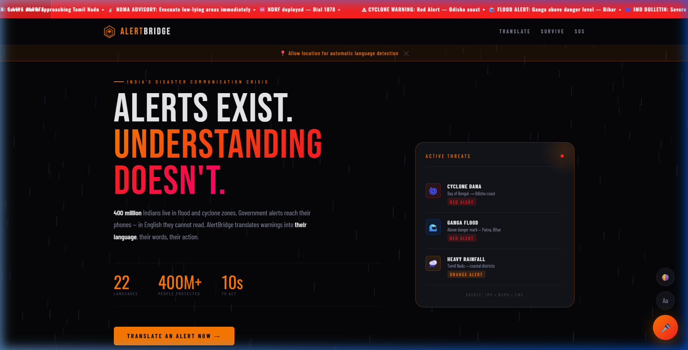
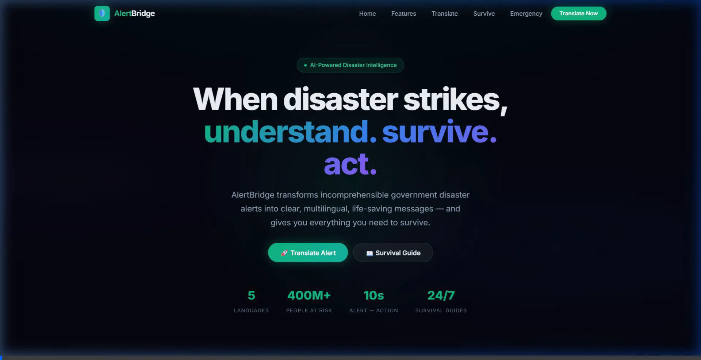
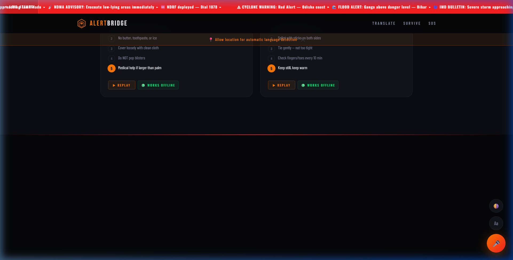

  

  <h1 align="center">ALERTBRIDGE.</h1>
  

    <strong>ALERTS EXIST. UNDERSTANDING DOESN'T.</strong>
     
    <em>India's First AI-Powered Disaster Survival Translation Network</em>
  

  
  

    
    
    
  

 

## 📖 The Story: The Gap That Kills

In India, **400 million people** live in flood and cyclone zones. Every year, when disaster strikes, the government sends out life-saving alerts. 
But there is a fatal flaw in the system: **The Gap That Kills**.

Ram receives an SMS: 
> *"Severe Cyclonic Storm Warning. Deep depression over Bay of Bengal (13.5°N, 87.2°E). Wind 100-110 kmph. NDMA advises immediate evacuation."*

Ram doesn’t speak English. He doesn’t understand technical jargon. He doesn’t know what a "deep depression" means. So he waits. He asks a neighbor. Hours pass. The storm hits.

**AlertBridge** bridges this gap. It takes complex, bureaucratic government disaster warnings and uses ultra-fast LLMs (Llama 3.3 via Groq) to instantly translate, adapt, and restructure them into localized, actionable, human-readable survival protocols in 12+ regional Indian languages.

  

## ✨ Core Innovations

- **10-Second Survival Pipeline**: A 3-Agent architecture (Extraction ➔ Adaptation ➔ Formatting) that breaks down a complex IMD bulletin and translates it to colloquial Hindi, Odia, Tamil, or Bengali perfectly.
- **Offline Survival Guides**: Beautifully animated SVG survival protocols (CPR, Bleeding, Rescue Signals) that are hardcoded directly into the application, guaranteeing access even when the cellular network is annihilated by the storm.
- **Zero-Dependency Architecture**: AlertBridge is radically designed. It uses **zero libraries**, **zero build steps**, and **no frameworks**. The entire platform—HTML, CSS, complex Canvas animations, state management, and the AI engine—is bundled into a single, bulletproof `index.html` file that can directly be launched from any device's local memory.
- **Flawless Accessibility**: Natively features fluid mathematical scaling (A- to A+ text resize), dynamic "Overcast Thunderstorm" Light Mode, and Voice TTS support locally orchestrated via standard Web APIs.

  
  
<em>Animated SVG Offline Survival Guides</em>

## 🛠️ How to Deploy & Use

We believe in maximum friction-less deployment. There is no `npm install`.

1. **Clone the repo** to your computer.
2. Open `index.html` directly in your browser.
3. *That's it.*

### Providing your API Key
AlertBridge relies on the ultra-low latency Groq Inference API to run `llama-3.3-70b-versatile`. 
When you open the app, it will **prompt you** for your Groq API Key, safely caching it locally in your browser's `localStorage` so it never leaves your machine. 

## 🔋 Technologies Used
- **Vanilla JavaScript**: Robust, dependency-free architecture.
- **Canvas API**: Generative rendering of stormy atmospheric layers, dynamic rainfall, and procedural lightning bolts.
- **CSS Grid/Variables**: Complete dark-mode / light-mode design systems using solely vanilla CSS.
- **Llama 3.3**: Utilizing `llama-3.3-70b-versatile` over Groq for intelligent reasoning and linguistic localization.

---

> *"Built with ❤️ by M S Abhishek to save lives across India."*
